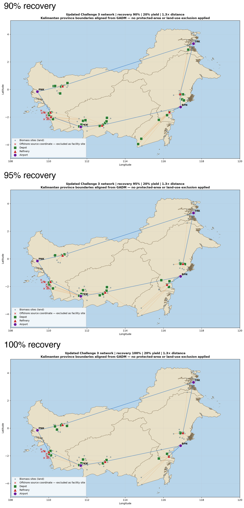

# SAF Supply-Chain Optimizer

This repository contains a mixed-integer linear programming model for planning a sustainable aviation fuel (SAF) supply chain in Kalimantan.

The model asks:

> Which biomass sources, depots, and refineries should be used to supply airport SAF demand at minimum annualized cost?

## Model

The network is:

```text
biomass sources -> depots -> refineries -> airports
```

The MILP chooses facility openings and material flows. Its objective minimizes annualized facility capital cost, fixed operating cost, biomass transport cost, processing cost, and a large penalty for unmet system demand.

Constraints enforce source recovery, facility capacities, flow balance, refinery yield, airport demand caps, and the total SAF requirement. Facility candidates are restricted to inland biomass coordinates because the supplied protected-area figure is not a georeferenced exclusion dataset and arbitrary construction sites are not otherwise validated for land access.

## Scenarios

| Recovery | Cost | Depots | Refineries |
|---:|---:|---:|---:|
| 90% | $918.44M | 35 | 6 |
| 95% | $902.34M | 27 | 6 |
| 100% | $896.47M | 23 | 6 |

These are feasible HiGHS incumbents found within a 120-second time limit; they are not claimed to be proven global optima. The maps show great-circle route arcs over a Kalimantan boundary layer. Offshore biomass records are retained as source data but excluded from facility locations.

## Visual results

The three scenario solutions are shown together below. Each panel shows biomass sources, selected depots, selected refineries, airports, and great-circle flow routes.



Individual scenario maps are also available:

- [90% recovery map](outputs/network_recovery_09.png)
- [95% recovery map](outputs/network_recovery_095.png)
- [100% recovery map](outputs/network_recovery_10.png)
- [Protected-area reference overlay](outputs/protected_area_reference_overlay.png)

## Key assumptions

- 1,200 kt/year total SAF requirement;
- maximum 300 kt/year delivered to each airport;
- 0.20 tonnes SAF per tonne of biomass;
- facility capacity measured as annual biomass intake;
- 20-year capital-cost annualization;
- fixed operating cost equal to 5% of capital cost per year;
- transport distance is great-circle distance multiplied by 1.3 as a road-distance proxy;
- 90%, 95%, and 100% recovery are scenario assumptions, not measured recovery rates.

The model is a planning benchmark. Road-network routing, validated land-use exclusions, and more precise biomass-yield data should be added before using it for investment decisions.

## Run the model

```bash
python3 -m pip install -r requirements.txt
python3 optimize.py
python3 report_metrics.py
```

Important files:

- `optimize.py` — baseline MILP;
- `config.py` — model configuration;
- `free_siting_warm_start.py` — local free-siting experiment using a HiGHS MIP start;
- `data/` — challenge inputs and geographic data;
- `outputs/` — scenario results, utilization tables, and network maps;
- `SAF_Optimization_Technical_Report.pdf` — full mathematical-modeling report.

## Interpretation

The solutions use many low-capacity depots and a smaller number of larger refineries. This follows from the supplied cost and capacity structure: depots collect geographically dispersed biomass, while refineries aggregate material and benefit from scale. The exact facility pattern should be interpreted together with the scenario assumptions and solver time-limit status.
